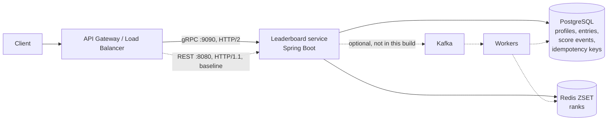
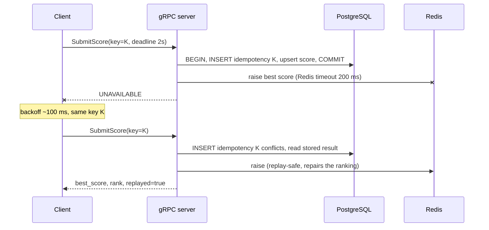

# Game Leaderboard: gRPC service with a REST/JSON baseline

A leaderboard service in Java 21 / Spring Boot 4 that exposes the same business logic twice: as a **gRPC service over HTTP/2 with Protobuf** (the protocol chosen in SLS1) and as a **REST/JSON API over HTTP/1.1** used as the measurement baseline. Writes are **idempotent** (client-supplied idempotency key plus a natural `match_hash` guard), every hop has a **timeout**, and the client **retries** only transient failures with exponential backoff. Rankings live in a Redis sorted set; PostgreSQL is the source of truth. The repository includes tests that prove the idempotency, retry and deadline behaviour, and a benchmark harness that measures latency, throughput, payload size and bytes on the wire for both protocols.

## 1. Architecture



Both the gRPC service and the REST controller are thin adapters over one `LeaderboardCore`, so any measured difference comes from the protocol and serialization, not from business logic.

## 2. Why gRPC

| Topic | Decision | Why |
| --- | --- | --- |
| Service protocol | gRPC over HTTP/2 + Protobuf | Binary payloads (estimated 0.5 KB writes, 5 KB reads), multiplexed connections, built-in deadlines, retries, server streaming |
| Real-time table updates | gRPC server streaming (`WatchTop`) | Same contract and tooling; WebSocket is only needed at the browser edge |
| Baseline | REST/JSON on Spring MVC calling the same core logic | Isolates the protocol cost from business logic |
| Ranking store | Redis sorted set (ZSET) | O(log N) rank, top-N and neighbour range queries |
| Source of truth | PostgreSQL | Profiles, entries, match events, idempotency records |
| Kafka + workers (from the HLD) | Not in this build: writes go to Postgres, then Redis | Keeps the protocol work measurable (see Limitations) |

## 3. API contract

The contract is [`src/main/proto/leaderboard/v1/leaderboard.proto`](src/main/proto/leaderboard/v1/leaderboard.proto). It evolves by adding fields with new numbers only.

| gRPC (`leaderboard.v1.LeaderboardService`) | REST baseline |
| --- | --- |
| `SubmitScore` | `POST /v1/leaderboards/{id}/scores` + `Idempotency-Key` header |
| `GetTop` | `GET /v1/leaderboards/{id}/top?limit&offset` |
| `GetNeighbors` | `GET /v1/leaderboards/{id}/users/{uid}/neighbors?radius` |
| `GetUserRank` | `GET /v1/leaderboards/{id}/{uid}` |
| `WatchTop` (server streaming) | none: REST would need WebSocket or SSE |

Errors map the same way on both sides, and only the transient one is retried:

| Cause | gRPC status | HTTP | Client retries? |
| --- | --- | --- | --- |
| Bad UUID, negative score, missing key or match hash, unknown user/board | `INVALID_ARGUMENT` | 400 | no |
| User not ranked | `NOT_FOUND` | 404 | no |
| Idempotency key reused with a different payload | `ALREADY_EXISTS` | 409 | no |
| Pool exhausted, statement timeout, Redis down or slow | `UNAVAILABLE` | 503 | **yes** |

## 4. Idempotency, timeouts and retries

**Idempotency.** The client generates one `idempotency_key` per logical write and sends it on every attempt (`client/LeaderboardClient`, `client/RestLeaderboardClient`). In `LeaderboardCore.submitScore`:

1. The first statement of the transaction is `INSERT INTO idempotency_keys ... ON CONFLICT DO NOTHING`. A concurrent request with the same key blocks on the unique index until the first transaction commits, so two parallel attempts can never both apply the write.
2. On conflict the stored request hash (SHA-256 of board, user, score, match) is compared. Same hash: the stored result is returned with `replayed = true`. Different hash: `ALREADY_EXISTS` / 409.
3. `score_events` (primary key `board, match_hash, user`) is a second guard: the same match result is never counted twice, even under a new key.
4. The best score is kept with `GREATEST(...)` in Postgres and a Lua compare-and-set in Redis, so applying it twice is harmless.
5. Redis is updated after the commit. If Redis fails at that point the call returns `UNAVAILABLE`; the client's retry is recognised as a replay and repairs Redis. This exact scenario is an integration test (`retryAfterRedisFailureReplaysAndRepairsRanking`).



**Timeouts.** Each inner timeout is smaller than the deadline of the caller above it. gRPC propagates the client's deadline to the server, and the service checks it (`grpc/Deadlines`) before doing work for a caller that has already given up.

| Hop | Timeout |
| --- | --- |
| Client write deadline (all attempts) | 2000 ms |
| Client read deadline (all attempts) | 1000 ms |
| Hikari connection wait | 500 ms |
| Postgres statement (`statement_timeout`) | 800 ms |
| Redis command | 200 ms |
| Retry backoff | exponential from 100 ms, x2, max 1 s, full jitter, max 4 attempts |

**Retries.** The gRPC channel retries from a service config (`client/RetryConfig`): only `UNAVAILABLE`, 4 attempts max, inside the call's deadline. `DEADLINE_EXCEEDED` is never retried by the channel (the budget is spent and the outcome is unknown); for writes the client makes one more attempt with the same key, which the idempotency key makes safe. The REST client applies the same rules to `503` and connection errors.

## 5. How to run

Requirements: JDK 21, Maven 3.9+, Docker.

```bash
docker compose up -d                                   # PostgreSQL + Redis (compose.yaml)
mvn -DskipTests package
java -jar target/leaderboard-0.0.1-SNAPSHOT.jar --spring.profiles.active=seed   # first run: 100,000 players
# later runs: java -jar target/leaderboard-0.0.1-SNAPSHOT.jar
```

gRPC listens on `:9090` (server reflection is enabled, so `grpcurl -plaintext localhost:9090 list` works), REST on `:8080`.

```bash
LB=00000000-0000-0000-0000-000000000001
U=00000000-0000-0000-0000-000000009c40                 # player 40000
curl "localhost:8080/v1/leaderboards/$LB/top?limit=3"
curl "localhost:8080/v1/leaderboards/$LB/users/$U/neighbors?radius=5"
curl -X POST "localhost:8080/v1/leaderboards/$LB/scores" -H 'Content-Type: application/json' \
  -H 'Idempotency-Key: demo-1' -d "{\"userId\":\"$U\",\"score\":7000,\"matchHash\":\"m-1\"}"
# repeat the POST: same result with "replayed": true; change the score with the same key: 409
```

**Tests** (Docker must be running for the Testcontainers test):

```bash
mvn test
```

| Test | What it proves |
| --- | --- |
| `RetryAndDeadlineTest` (in-process gRPC) | `UNAVAILABLE` is retried with the same idempotency key and succeeds; retries stop at 4 attempts; `INVALID_ARGUMENT` / `NOT_FOUND` / `ALREADY_EXISTS` are never retried; a slow server fails with `DEADLINE_EXCEEDED` at the deadline, and the server sees the client's deadline |
| `GrpcErrorsTest` | transient failures (Redis timeout or down, connection pool exhausted, including the pool timeout raised when a transaction is opened) map to `UNAVAILABLE`; client mistakes never do |
| `LeaderboardServiceIntegrationTest` (PostgreSQL 16 + Redis 7 in Testcontainers) | 16 concurrent requests with one key apply once (15 replays, 1 score event); key reuse with another payload is rejected; the same match under a new key counts once; a lower score never lowers the best; a Redis outage after commit is repaired by the retry; gRPC and REST return the same data and the same error codes end to end |

**Benchmark** (against the running, seeded service):

```bash
bash bench/run-bench.sh            # smoke + payload + wire + latency + chaos, writes bench/out/results.md
bash bench/run-bench.sh latency    # one part only; tune with BENCH_OPTS="-Dbench.duration=60 -Dbench.runs=5"
```

## 6. Benchmark method

The harness is [`src/test/java/com/example/leaderboard/bench/Bench.java`](src/test/java/com/example/leaderboard/bench/Bench.java). It drives both protocols from one Java process with the **production clients** (deadlines and retries on), and it fully deserializes every response (Protobuf objects vs Jackson records), so both sides do the work a real caller does.

- Same machine, same data (the 100,000-player seed), same server process, same Redis and Postgres. One protocol at a time.
- Closed loop with 50 concurrent callers on both sides. gRPC multiplexes them over 10 HTTP/2 connections; REST uses the JDK HttpClient's HTTP/1.1 keep-alive pool (up to 50 connections). The connection model is part of the protocol comparison.
- No TLS on either side.
- Warm-up per scenario before measuring (JIT, caches, connections), then 3 measured runs; the tables show the median run values.
- Four scenarios: `top100` (large read), `neighbors` (small read, 11 entries), `rank` (tiny read, 1 entry), `submit` (write with a fresh idempotency key and match per call, random players and scores).
- Reads target player 40,000; benchmark writes skip that player, so read results stay stable.
- **Payload size**: the real response bodies of the running service, Protobuf vs JSON, raw and gzip.
- **Bytes on the wire**: a counting TCP proxy between client and server records every byte in both directions (headers, HTTP/2 frames, bodies) over 5,000 calls after warm-up, at 10 concurrent callers (bytes per call do not depend on concurrency).
- **Server CPU** is sampled from `/actuator/metrics/process.cpu.usage`; client CPU from the load generator's JVM.
- **Fault injection**: Redis is paused for 1 s during a submit run, with client retries on and off.

## 7. Results

Measured on one laptop (client, service, PostgreSQL and Redis on the same 4 cores); full output in
[`bench/out/results.md`](bench/out/results.md), per-run numbers in [`bench/out/bench-log.txt`](bench/out/bench-log.txt).

| setting | value |
|---|---|
| date | 2026-10-31T06:51:45.078067500Z |
| OS | Windows 10 10.0 (amd64), 4 logical CPUs, 12.8 GB RAM |
| JDK | Java HotSpot(TM) 64-Bit Server VM 21.0.10 |
| load | closed loop, 50 concurrent callers; gRPC over 10 HTTP/2 connections, REST over HTTP/1.1 keep-alive pool |
| timing | warm-up 10 s, then 5 runs x 20 s per scenario; table shows the median of the runs |
| client | the production clients in `client/` (deadlines + retries on), responses fully deserialized |

### Payload size (message body only)

Same data from the running service: Protobuf bytes from the gRPC response vs the REST response body.

| message | Protobuf B | JSON B | JSON / Protobuf | Protobuf gzip B | JSON gzip B |
|---|---:|---:|---:|---:|---:|
| GetTop response, 100 entries | 6666 | 11659 | 1.75x | 1313 | 1299 |
| GetTop response, 10 entries | 670 | 1162 | 1.73x | 242 | 255 |
| GetNeighbors response, 11 entries | 750 | 1312 | 1.75x | 260 | 271 |
| GetUserRank response, 1 entry | 70 | 122 | 1.74x | 63 | 105 |
| SubmitScore request (JSON body only) | 155 | 113 | 0.73x | 107 | 106 |
| SubmitScore response | 7 | 48 | 6.86x | 27 | 67 |

The SubmitScore JSON body leaves out the leaderboard id (in the URL path) and the idempotency key
(in the `Idempotency-Key` header), which Protobuf carries in the message. The wire table below includes them.

### Bytes on the wire per call

Counted by a TCP proxy between client and server: everything sent in both directions (HTTP headers,
HTTP/2 frames, bodies), steady state after 500 warm-up calls, averaged over 5000 calls at concurrency 10.
Both clients keep their connections open, so connection setup is excluded.

| call | gRPC up B | gRPC down B | gRPC total B | REST up B | REST down B | REST total B | REST / gRPC |
|---|---:|---:|---:|---:|---:|---:|---:|
| top100 | 79 | 6703 | 6783 | 145 | 11793 | 11938 | 1.76x |
| neighbors | 116 | 787 | 903 | 193 | 1420 | 1613 | 1.79x |
| rank | 111 | 107 | 218 | 168 | 229 | 397 | 1.82x |
| submit | 191 | 44 | 234 | 360 | 154 | 514 | 2.19x |

### Latency and throughput

50 concurrent callers, closed loop. p50/p95/p99 in ms, measured in the client around the full call
(serialize, send, server work, receive, deserialize). Median of 5 runs of 20 s each, after a 10 s warm-up.

| call | protocol | req/s | p50 ms | p95 ms | p99 ms | max ms | errors | server CPU | client CPU |
|---|---|---:|---:|---:|---:|---:|---:|---:|---:|
| top100 | gRPC | 3131 | 14.53 | 26.16 | 47.46 | 250.9 | 0 | 39% | 22% |
| top100 | REST/JSON | 2785 | 17.00 | 29.78 | 42.74 | 109.9 | 0 | 35% | 25% |
| neighbors | gRPC | 3731 | 12.75 | 20.52 | 29.61 | 104.5 | 0 | 36% | 19% |
| neighbors | REST/JSON | 3525 | 12.88 | 24.44 | 32.44 | 79.5 | 0 | 34% | 21% |
| rank | gRPC | 3920 | 12.02 | 19.82 | 29.29 | 77.3 | 0 | 35% | 19% |
| rank | REST/JSON | 3845 | 11.77 | 22.38 | 29.88 | 84.1 | 0 | 32% | 20% |
| submit | gRPC | 876 | 54.16 | 83.71 | 105.68 | 156.9 | 0 | 18% | 6% |
| submit | REST/JSON | 871 | 55.70 | 83.43 | 105.36 | 156.9 | 0 | 18% | 7% |

CPU is the average share of the whole machine (all cores) used by the server and the load generator process.

### Retries under a dependency failure

SubmitScore load for 8 s at concurrency 50; Redis is paused (`docker pause`) for 1 s starting at t = 3 s.
The server maps the Redis timeout to `UNAVAILABLE` / `503`; the client retries only those, reusing the idempotency key.

| protocol | client retries | successful writes | failed writes | error rate | failures by code | p99 ms | max ms |
|---|---|---:|---:|---:|---|---:|---:|
| gRPC | off | 5949 | 200 | 3.25% | {UNAVAILABLE=200} | 155 | 223 |
| REST/JSON | off | 5334 | 201 | 3.63% | {HTTP_503=201} | 135 | 175 |
| gRPC | on | 5646 | 0 | 0.00% | - | 161 | 1664 |
| REST/JSON | on | 5689 | 11 | 0.19% | {HTTP_503=11} | 130 | 1386 |

### Analysis

**Payload.** Protobuf is about 1.75x smaller than JSON for every read, because JSON repeats each field name in every entry (`"userId"`, `"username"`, ...) while Protobuf uses one-byte field tags. The gap is constant per entry, so it matters most for `top100` (6.7 KB vs 11.7 KB). After gzip both formats are about the same size (1.3 KB for `top100`): gzip removes exactly the repeated names that make JSON large, so gzip on REST closes the bandwidth gap but costs CPU on both sides. The one case where JSON is smaller is the `SubmitScore` request body, only because REST moves the board id into the URL and the idempotency key into a header; counted on the wire, REST is larger there too.

**Bytes on the wire.** Including headers and framing, REST sends 1.8x to 2.2x more bytes per call. The difference is largest for the small calls (`submit`: 514 B vs 234 B) because HTTP/1.1 resends its text headers on every request, while HTTP/2 compresses repeated headers with HPACK down to a few bytes. Our REST client sends very few headers; a browser or SDK with cookies, auth and user-agent headers would widen this gap.

**Latency and throughput.** For the large read (`top100`) gRPC delivered about 12% more requests per second (3,131 vs 2,785) with a 15% lower median latency (14.5 ms vs 17.0 ms), which is where serialization cost and payload size show. For the small reads (`neighbors`, `rank`) the protocols are within a few percent of each other: the cost is dominated by Redis, the profile cache and the JVM, not by the wire format. Writes are identical (about 875 req/s, p50 55 ms) because the PostgreSQL transaction (idempotency insert, score event, upsert, commit with fsync) dominates. Tail latency (p99) is similar on both sides; the gRPC `top100` max of 251 ms is a single outlier (GC or scheduling on the shared laptop). Server CPU per request is slightly lower for gRPC (39% CPU for 3,131 req/s vs 35% for 2,785 req/s, about the same per call), so the gain comes mostly from fewer bytes and multiplexed connections rather than cheaper processing. With client, server and databases sharing 4 cores, these absolute numbers are a lower bound; the relative differences are the meaningful result.

**Capacity check against the SLS1 estimate.** The estimate assumed 2,000 reads/s at 5 KB and 5,000 writes/s at 0.5 KB. With the measured `top100` wire sizes, 2,000 reads/s cost **13.6 MB/s with gRPC vs 23.9 MB/s with REST/JSON** (the 10 MB/s estimate was low, because a 100-entry page is 6.7 KB, not 5 KB). For 5,000 writes/s the inbound traffic is **0.96 MB/s with gRPC vs 1.8 MB/s with REST** (191 B vs 360 B per request). gRPC therefore cuts read bandwidth by about 43% and write bandwidth by about 47%, or the same as REST plus gzip for reads without its CPU cost.

**Retries under failure.** Pausing Redis for 1 s made about 3.5% of writes fail on both protocols when the client did not retry: every write in that window got `UNAVAILABLE` / `503` although its score was already committed in PostgreSQL, so the caller could not tell whether it counted, and the Redis ranking could miss it. With retries on, the gRPC client lost **no writes** and the REST client lost 11 of 5,700 (0.19%), those whose four attempts all fell inside the 1 s pause. The retried writes were recognised as replays by their idempotency key, so none was applied twice, and the retry repaired the Redis ranking. The price is tail latency during the outage (max about 1.4 to 1.7 s, still inside the 2 s write deadline). An earlier run of this benchmark also exposed a real bug: a connection-pool timeout while opening a transaction (`CannotCreateTransactionException`) was mapped to `INTERNAL` and therefore not retried; it is now `UNAVAILABLE` / `503` and pinned by `GrpcErrorsTest`.

**Conclusion.** gRPC's main measurable advantage for this service is size: 1.75x smaller messages and about 2x fewer bytes on the wire, which translates into higher throughput only where payloads are large (`top100`). For small calls and writes, the backend (Redis, PostgreSQL) dominates and the protocols perform the same. The other reasons for choosing gRPC are functional rather than speed: deadline propagation, a declarative retry policy, a typed contract shared by client and server, and server streaming for the live table (`WatchTop`) on the same connection.

## 8. Limitations and next steps

- **No TLS or authentication yet.** Both would be added at the gateway (mTLS between gateway and service) and apply equally to both protocols.
- **Kafka and workers from the HLD are omitted.** To plug them in, replace the transaction body with a transactional outbox: insert the idempotency row and an outbox record, return, and let a worker do the entry upsert and `ranking.raise`. Both steps are already replay-safe, so Kafka's at-least-once delivery is fine.
- **Hot-board sharding.** One ZSET per board; if a single board becomes the bottleneck, split it by score bucket. Keys already use a Redis Cluster hash tag (`lb:{id}`).
- **Reconciliation job.** A periodic job should rebuild Redis from Postgres (the seed runner already does this for one board) to repair any drift a client that never retries could leave behind.
- **Season-end rewards**: a scheduled job over `leaderboard_entries` (`LeaderboardEntryRepository.pageForRewards`).
- **Tie-breaking**: equal scores are ordered by user ID (Redis member order), which is deterministic but not "first to reach the score". A composite score (points, then earliest timestamp) would fix that.
- **Idempotency-key retention**: keys are never deleted yet. A daily job should delete keys older than 24 h (`IdempotencyKeyRepository.deleteOlderThan`).
- **WatchTop is per instance.** With several replicas, `ScoreChanged` should be fanned out through Redis Pub/Sub or Kafka so every replica flushes.
- **Benchmark scope.** Everything runs on one laptop (client, server, Postgres and Redis share 4 CPUs), so absolute numbers are low and the client competes with the server for CPU. Relative differences are the meaningful result. Run on separate machines for production capacity numbers.
- **REST request headers are minimal.** The JDK HttpClient sends very few headers; browsers and SDKs typically send more (user agent, cookies, auth), which widens the HTTP/1.1 vs HPACK gap in practice.

## 9. Repository layout

```
src/main/proto/leaderboard/v1/leaderboard.proto   gRPC contract
src/main/java/com/example/leaderboard/
  core/        Models, LeaderboardCore (idempotent writes), RankingStore (Redis ZSET), ProfileCache
  grpc/        LeaderboardGrpcService, GrpcErrors (status mapping), Deadlines, TopBroadcaster (WatchTop), Pb
  rest/        LeaderboardRestController, RestErrors (REST/JSON baseline)
  client/      LeaderboardClient (gRPC), RestLeaderboardClient, RetryConfig
  seed/        SeedRunner (profile "seed")
  entity/, repository/   JPA model of the domain (users, boards, entries, games, events, keys)
src/main/resources/application.properties   ports and timeouts
src/main/resources/db/migration/            Flyway migrations
src/test/java/com/example/leaderboard/
  RetryAndDeadlineTest, LeaderboardServiceIntegrationTest
  bench/Bench.java                          benchmark harness
bench/run-bench.sh                          runs the harness
bench/out/results.md                        latest measured results
compose.yaml                                PostgreSQL + Redis
```
